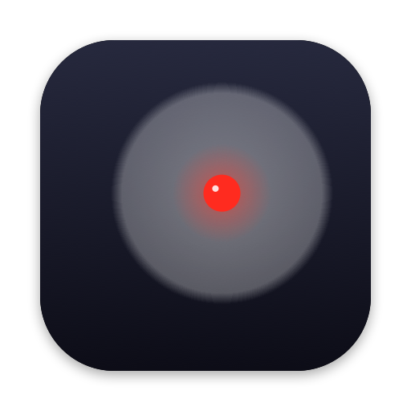

<p align="center"></p>

# Logiminus

A tiny macOS menu bar app (and CLI) that drives the **Logitech Spotlight 2** presentation
remote — laser pointer, spotlight, slide navigation and haptics — without Logi Options+.

> **Not affiliated with Logitech.** This is an independent project, born out of necessity:
> Logi Options+ kept randomly stealing window focus and lagging out my keyboard. Logiminus does
> the few things I need from it, and nothing else. Logitech and Spotlight are trademarks of
> Logitech.

## What it does

| On the remote | What happens |
|---|---|
| Top button, light press + hold | Red laser dot, moved by pointing the remote |
| Top button, hard press | Spotlight — the screen dims around a circle |
| Top button, quick tap | Nothing by default (or a left click — menu → Top button tap) |
| Next / Back | → / ← (next / previous slide) |
| Hold Next | Next slide |
| Hold Back | ⇧B (black screen) during a presentation, otherwise steps back repeatedly |

Plus, from the menu bar: pointer/spotlight size and speed, jitter smoothing, which effect light and hard press
trigger, haptic feedback strength, a presentation timer that vibrates 5 min and 1 min before
the end, and the battery level.

Works with multiple displays: the pointer starts on the screen showing your slideshow (or pick
a display in the menu) and can be moved across screens. The overlay never takes focus and the
app installs no keyboard hooks.

Works over Bluetooth and through the Logitech USB receiver.

## Install

Requires macOS 13+ and Xcode command line tools (`xcode-select --install`).

```sh
git clone https://github.com/raphaelluethy/logiminus.git
cd logiminus
scripts/build-app.sh --install
```

This builds `~/Applications/Logiminus.app`, links the CLI to `~/.local/bin/logiminus` and
starts the app. Then:

1. **Grant Accessibility** when asked (System Settings → Privacy & Security → Accessibility).
   It is needed to send the arrow keys.
   For Bluetooth, also grant **Input Monitoring** — macOS treats the remote as a keyboard, so
   the app needs it to talk to the device at all.
2. **Quit Logi Options+** — two apps can't drive the remote at once. To stop it until the next
   login: `launchctl bootout gui/$(id -u)/com.logi.cp-dev-mgr`.
3. Optional: menu bar icon → **Open at Login** (or `logiminus login on`).

The build is signed with your first Apple Development identity if you have one (so the
Accessibility permission survives rebuilds), otherwise ad-hoc. Override with
`LOGIMINUS_SIGN_IDENTITY="…"`.

## Use

Everything is in the menu bar icon. The CLI talks to the running app:

```sh
logiminus enable      # take over the remote (starts the app if needed)
logiminus disable     # hand the buttons back to the remote's built-in behaviour
logiminus toggle
logiminus status      # e.g. "enabled · Spotlight 2 connected · battery 50%"
logiminus timer start 20 | stop
logiminus login on | off  # open at login
logiminus haptic 17   # play a vibration pattern
logiminus quit
```

### Raycast

The `raycast/` folder has script commands **Logi On**, **Logi Off** and **Logi Toggle**. In
Raycast: Settings → Extensions → Script Commands → Add Directories → pick the `raycast`
folder (or copy the scripts into your existing script folder).

## How it works

Logiminus speaks Logitech's HID++ 2.0 protocol to the remote through the receiver: it diverts
the buttons (feature `0x1B04`) so they are reported to the app instead of acting natively,
receives the gyro motion as raw XY deltas, and drives the haptics motor (`0x19B0`). Protocol
notes from reverse engineering are in [docs/protocol.md](docs/protocol.md).

`logiminus monitor [--divert] [-v]` prints the device traffic for debugging.
`swift test` runs the unit tests (IPC, connection ordering, timer); they don't need the remote.

## License

MIT — see [LICENSE](LICENSE).
